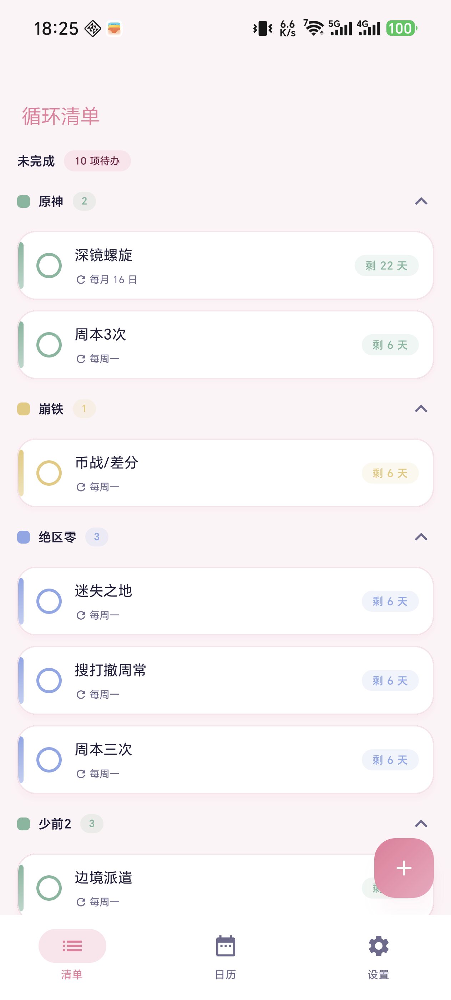
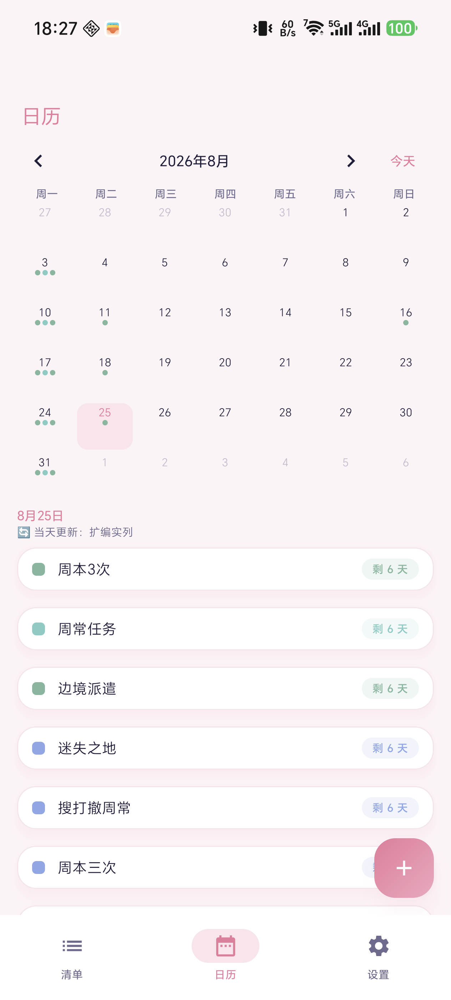
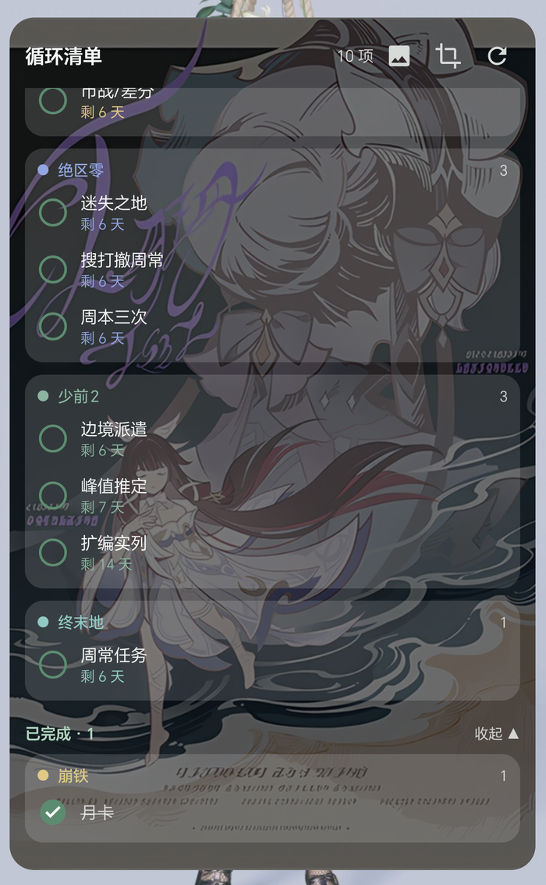

# 循环清单（Gametodolist）

一款 Android 循环待办清单 App：任务按规则自动循环（每天 / 每 N 天 / 每周几 / 每月几日），到期未完成自动作废并生成新周期，已完成划线保留不消失。配套可交互的桌面小组件（点按即完成，支持自定义壁纸与裁剪）。

## 截图

<p>
  
  
  
</p>

## 功能

- **循环任务**：不循环（可设持续天数，到期作废可重新开启）/ 每 N 天 / 每周几（可多选）/ 每月几日（短月自动落到月末）；每周、每月可指定开始日期。
- **显示时段**：整循环 / 长期有效 / 自定义 N 天。
- **主页三分区**：未完成、已完成（划线，可撤销）、已作废（可编辑、可重新开启），再按分类分组；分类可折叠、左滑删除有确认。
- **日历视图**：预演任意日期（含未来）的当天任务，循环更新日打点，一键回到今天。
- **到期提醒**：精确闹钟（Android 14+ 未授权自动降级不崩溃），开机自动重排。
- **桌面小组件**：按分类分组展示，点任务行即完成/取消，已完成区可展开收起；外观支持纯色（透明度）与自定义壁纸（亮度调节、按组件框选显示区域、比例预设）。
- **分类管理**：增删改 + 预设色板 + emoji 图标。

## 技术栈

Kotlin · Jetpack Compose（Material 3）· Room · Hilt · WorkManager · Glance（桌面小组件）

- minSdk 26 / targetSdk 35
- 架构：domain 纯函数业务规则（循环引擎/结算器，JVM 单测）+ Room 数据层 + 统一写后管线（结算→重排提醒→刷新组件）+ Compose UI + Glance 小组件
- 42 例单元/集成测试（JUnit + Robolectric 真实 Room 迁移测试）

## 构建

需要 JDK 17 与 Android SDK（API 35）：

```bash
./gradlew assembleDebug        # Windows: gradlew.bat assembleDebug
./gradlew test                 # 运行单元测试
```

也可以直接用 Android Studio 打开本目录。

## 文档

- [DEVELOPMENT.md](DEVELOPMENT.md) — 架构设计、各模块职责、关键设计决策与开发约定
- [CHANGELOG.md](CHANGELOG.md) — 更新日志
- [AGENTS.md](AGENTS.md) — 项目速览与构建/调试要点（面向协作者与 AI 助手）
