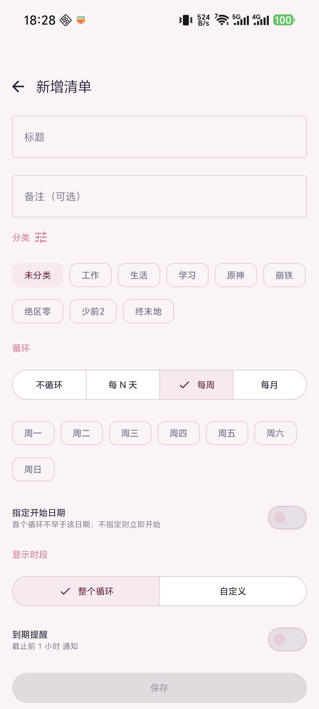
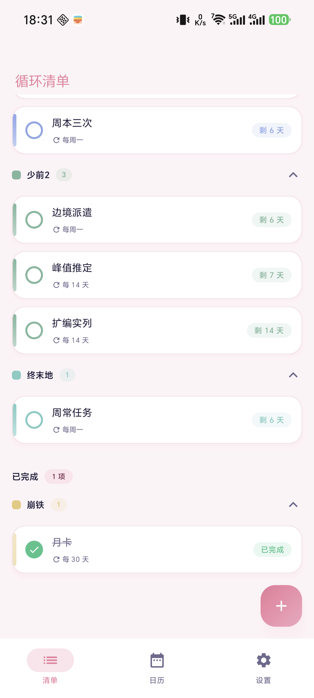
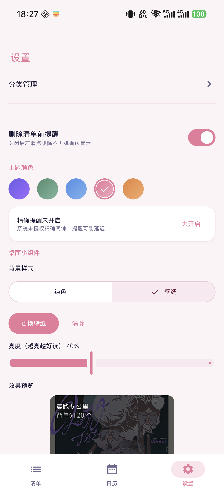
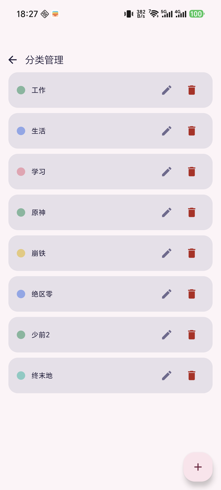

# 循环清单（Gametodolist）

> 一款为「周期性事务」而生的 Android 待办清单：定好规则，剩下的交给时间。

周本刷新、月卡续期、深渊结算、每月还款日……这些事不是"做一次就完"，而是**每隔一段时间准时回来找你**。普通待办 App 里你要么手动重建，要么被过期任务刷屏。循环清单的思路是：任务按规则**自动循环**，到期没做就**自动作废**并生成新周期，做完的**划线留档**不消失——配上一块能直接点按完成的桌面小组件，抬头一看就知道今天该干什么。


<p>
  
  
  
</p>

## ✨ 功能亮点

### 🔁 四种循环规则，覆盖所有"又来了"的场景

| 规则 | 适合什么 | 举例 |
| --- | --- | --- |
| 不循环 | 一次性任务（可设持续天数） | 限时活动，到期作废不续期 |
| 每 N 天 | 固定间隔刷新 | 每 14 天的峰值推定、每 30 天的月卡 |
| 每周几 | 周本 / 周常（可多选几天） | 每周一刷新的周本三次 |
| 每月几日 | 月度结算（短月自动落到月末） | 每月 16 日的深镜螺旋 |

- 每周 / 每月规则可**指定开始日期**：首个循环不早于该日，适合"下版本才开始"的任务。
- 每条任务可独立设置**显示时段**：整个循环都展示、长期有效，或只在截止前 N 天出现——不重要的不占地方。
- 到期未完成不会默默堆积：自动作废归档，同时新的周期已经排好。

<p>
  
</p>

### 📋 主页四分区：要做的、做完的、作废的、停用的，一眼分清

- **未完成**：按分类分组展示，剩余天数胶囊提示紧急度（≤2 天变橙、已截止变红）。
- **已完成**：划线留档不消失，点实心勾随时撤销——误点也不怕。
- **已作废**：过期任务在这里躺着，可以点击编辑（保存即复活）、左滑删除，或"重新开启"让它从今天重新生效。
- **已停用**：左滑选"停用"后灰化划线，循环仍继续计时，组件、日历和提醒不再出现；再左滑选"恢复"即可回来。
- 分类可折叠收起；左滑露出停用/删除按钮，点击才执行，删除前有确认弹窗（可选"不再提醒"）。

<p>
  
  
</p>

### 🗓 日历预演：看看未来任何一天要做什么

- 点任意日期（包括未来），引擎现场推算当天的任务列表——下周三忙不忙，翻一翻就知道。
- 日历上的圆点标记**循环更新日**，哪天刷新一目了然；翻远了点"今天"一键回来。

### 🔔 到期提醒：该响的时候一定响

- 截止前 1 小时精确闹钟通知；Android 14+ 未授权精确闹钟时自动降级为普通闹钟，不崩溃不丢提醒。
- 重启手机后开机自动重排所有提醒，不用重新打开 App。

### 🖼 桌面小组件：不用打开 App，点一下就完成

- 任务按分类分组展示，**点整行即完成/取消**，已完成区可展开收起。
- 外观随你折腾：**纯色**（透明度可调）或**自定义壁纸**（亮度可调），壁纸支持按组件**框选显示区域**——选框可拖动、双指缩放，带 1:1 / 4:3 / 16:9 等比例预设，所见即所得。
- 换壁纸是"暂存式提交"：选好图裁好区域，点保存才生效；中途反悔退出，旧壁纸原样保留。

<p>
  
  
</p>

### 🎨 分类与主题

- 分类增删改 + 预设色板，游戏一个色、生活一个色，清单不再大锅烩。
- 5 套浅色主题预设（默认图鉴紫），设置页点一下就换装。

<p>
  
</p>

### 🤏 细节体验

- 编辑页有改动时返回会弹"放弃修改？"确认，手滑不丢编辑成果。
- 高刷新率适配：窗口钉住 120Hz 显示模式，解除部分机型（荣耀 / MagicOS）对第三方应用的 60Hz 渲染封顶，滑动起步不卡。
- 主页与日历底部留白避让悬浮添加按钮，最后一行任务永远点得到。

## 🧠 它是怎么工作的

每个任务拆成两层：**模板**存循环规则（每 N 天 / 每周几……），**实例**存某一个周期的窗口与状态（进行中 / 已完成 / 已作废）。每天（以及你每次打开 App、改动任务）结算器都会跑一遍：到期的实例作废归档，按模板规则补上新的实例。所以"编辑模板"不会弄丢历史——过去的完成记录都是独立实例，原样保留。

## 🛠 技术栈

Kotlin · Jetpack Compose（Material 3）· Room · Hilt · WorkManager · Glance（桌面小组件）

- minSdk 26 / targetSdk 35
- 架构：`domain` 纯函数业务规则（循环引擎 / 结算器 / 裁剪计算，不碰 Android API）+ Room 三表数据层（模板 / 实例 / 分类，带迁移与唯一索引）+ 统一写后管线（任何写操作后自动结算 → 重排提醒 → 刷新小组件）+ Compose UI + Glance 小组件
- 72 例单元 / 集成测试：业务规则走 JVM 纯函数测试，数据库迁移与"编辑模板不丢实例历史"等数据完整性走 Robolectric 真实 Room（内存库）集成测试

## 📦 构建

需要 JDK 17 与 Android SDK（API 35）：

```bash
./gradlew assembleDebug        # Windows: gradlew.bat assembleDebug
./gradlew test                 # 运行单元 / 集成测试
```

也可以直接用 Android Studio 打开本目录。

## 📚 文档

- [DEVELOPMENT.md](DEVELOPMENT.md) — 架构设计、各模块职责、关键设计决策与开发约定
- [CHANGELOG.md](CHANGELOG.md) — 更新日志
- [AGENTS.md](AGENTS.md) — 项目速览与构建 / 调试要点（面向协作者与 AI 助手）
